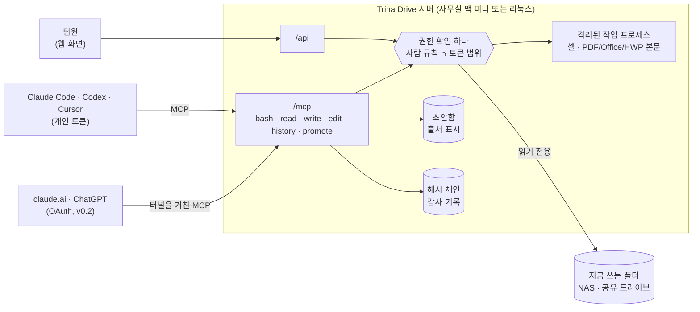

<p align="center">
  <a href="https://drive.trina.app"></a>
</p>

<h1 align="center">Trina Drive</h1>

<p align="center">
  <b>우리 팀 AI 에이전트에게 회사 파일을</b><br>
  사람마다 허락된 것만 보이고, 원본은 건드리지 않고, 모든 일이 기록돼요.
</p>

<p align="center">
  <a href="#라이선스"></a>
  <a href="https://github.com/potenlab/trina-drive/actions/workflows/ci.yml"></a>
  <a href="docs/DOCKER.md"></a>
  
  
</p>

<p align="center">
  <a href="https://drive.trina.app">웹사이트</a> ·
  <a href="#빠르게-시작하기">빠르게 시작하기</a> ·
  <a href="docs/ARCHITECTURE.md">문서</a> ·
  <a href="docs/SECURITY-MODEL.md">보안 모델</a> ·
  <a href="https://drive.trina.app/#pricing">요금</a> ·
  <a href="README.md">English</a>
</p>

---

Trina Drive는 **AI 에이전트를 위한 오픈소스 팀 파일 서버**예요. 우리 서버에 설치하고, 지금 쓰는 폴더(NAS 공유 폴더,
사무실 맥의 공유 드라이브)를 그대로 연결하면 돼요. Claude Code, Codex, Cursor, claude.ai, ChatGPT가 MCP로 붙어요.

에이전트는 진짜 셸(`ls`, `grep -r`, `cat`, 파이프)로 일하지만, 그 안에는 **그 사람이 읽을 수 있는 파일만** 있어요.
토큰마다 범위를 더 좁힐 수도 있어요. 원본은 읽기 전용이고, 에이전트는 자기 초안함에만 써요. 모든 호출은 해시 체인으로
묶인 감사 기록에 남아요.

<!-- TODO(출시): 20초 데모(kim과 boss가 Claude Code에서 같은 질문을 하는 장면)를 docs/assets/demo.gif로 녹화하고
     (5 MB 이하, 가로 1200 px) 아래 줄의 주석을 풀 것.
<p align="center"></p>
-->

같은 서버에 같은 질문을 해도 사람마다 답이 달라요. `kim`은 프로젝트 팀원이고, `boss`는 대표예요.

```console
$ tdrive sh --token $KIM -c 'ls /'                    # kim의 에이전트에는 경영 폴더가 아예 없어요
drafts
개인_kim
공용
프로젝트

$ tdrive sh --token $KIM -c 'grep -rl 매출 /'          # kim이 볼 수 있는 곳에는 결과가 없어요 (exit 1)

$ tdrive sh --token $KIM -c 'ls /경영'
ls: /경영: No such file or directory                  # 숨긴 폴더는 없는 폴더와 똑같이 보여요
$ tdrive sh --token $KIM -c 'ls /없는폴더'
ls: /없는폴더: No such file or directory

$ tdrive sh --token $KIM -c 'echo hi > /프로젝트/README.md'
bash: /프로젝트/README.md: Originals are read-only. Write to /drafts/ and a person will move it.

$ tdrive sh --token $KIM -c 'grep -c 견적 /프로젝트/*.md > /drafts/견적_요약.md && ls /drafts'
견적_요약.md                                          # 초안은 어느 폴더에서 왔는지 기억해요

$ tdrive sh --token $BOSS -c 'grep -r 매출 /'
/경영/손익_요약.xlsx:매출	1240000000                   # xlsx, docx, pdf, hwp(x) 안의 글자도 grep돼요
/경영/손익.csv:매출,1240000000

$ tdrive audit verify
audit chain ok: 6 rows, head 1539812405509ecb…
```

`tdrive demo seed`의 예시 회사로 실제로 돌린 결과에 주석만 붙였어요. ([직접 해 보기](#2분-만에-써-보기))

## 왜 만들었나

AI 에이전트는 파일과 셸을 쓸 때 가장 일을 잘해요. 그런데 가장 위험한 것도 그때예요. 회사 자료, 믿을 수 없는 입력, 밖으로
보내는 길이 한데 모이면 자료가 새요. Simon Willison은 이걸
[lethal trifecta](https://simonwillison.net/2025/Jun/16/the-lethal-trifecta/)라고 불러요. 지금 작은 팀이 고를 수 있는 길은 이 정도예요.

- **공유 드라이브를 노트북마다 동기화하고 Claude Code를 돌리기.** 진짜 셸이고 공짜예요. 대신 에이전트가 노트북에 있는 걸
  전부 보고, 무엇을 읽었는지 아무도 몰라요. HWP·PDF 본문은 `grep`으로 찾을 수 없어요.
- **클라우드 드라이브의 MCP 커넥터**(Google Drive, Box). 먼저 파일을 전부 그쪽 클라우드로 옮겨야 해요. 셸이 없고,
  에이전트 통제는 최상위 요금제에만 있어요.
- **기업용 검색**(Glean, Dust). 큰 회사와 SaaS 자료에 맞춰져 있고, 1인당 요금이에요. 우리 NAS를 위한 도구가 아니에요.
- **NAS 회사의 MCP**(QNAP MCP Assistant). AI에게 NAS 계정 하나를 줘요. 사람마다 다르게 보이지 않고, 초안함도 출처 표시도 없어요.

Trina Drive는 파일을 지금 자리에 그대로 두고, 에이전트가 파일에 닿는 모든 길(셸, 파일 도구, 검색, 웹) 앞에
**권한 확인 하나와 감사 기록 하나**를 둬요.

## 주요 기능

- 🔒 **사람마다 다른 에이전트 권한.** 에이전트가 보는 범위는 그 사람의 AI 규칙과 토큰 범위가 겹치는 곳뿐이에요.
  인턴의 Claude Code에는 "이 프로젝트 폴더만, 읽기만, 7일 동안"처럼 줄 수 있어요.
- 👻 **볼 수 없는 파일은 없는 파일.** 출력, 오류 문구, 종료 코드까지 없는 경로와 똑같아요. 폴더 이름도 크기도 새지 않아요.
- 🐚 **에이전트를 위한 진짜 셸.** 가상 트리 위에서 `ls`, `find`, `grep -r`, `sed`, `awk`, `wc`, 파이프를 그대로 써요
  ([just-bash](https://github.com/vercel-labs/just-bash)). `grep`은 ripgrep으로 돌아가요.
- 📄 **문서 본문 검색.** PDF, DOCX, XLSX, PPTX, HWP, HWPX를 글자로 읽어요. 파싱은 격리된 작업 프로세스에서 해요.
- ✍️ **원본은 그대로.** 에이전트는 `/drafts/`에만 쓰고, 초안에는 출처 폴더가 붙어요. 초안을 더 넓은 폴더로 올리려면
  사람이 패스키로 승인해야 해요(v0.2).
- 🧾 **전부 기록.** 모든 호출을 해시 체인으로 남기고, 서명한 기준점을 서버 밖으로 보내요. 대량 읽기, 새 클라이언트,
  원본 쓰기 시도는 바로 알려 드리고, 클릭 한 번으로 연결을 끊을 수 있어요.
- 🖥️ **사람을 위한 웹 화면.** 폴더, 규칙, 토큰, 승인함, 감사 기록, 읽기 전용 파일 탐색기까지 한국어로 써요.
- 🔌 **MCP를 쓰는 AI라면 어디서나.** Claude Code, Codex, Cursor는 개인 토큰으로, claude.ai와 ChatGPT는 OAuth로 붙어요(v0.2).

## 동작 방식



자세한 구조는 [docs/ARCHITECTURE.md](docs/ARCHITECTURE.md)에 있어요.

## 빠르게 시작하기

### 2분 만에 써 보기

[Bun](https://bun.sh) 1.3, ripgrep, poppler가 필요해요(`brew install ripgrep poppler`, 리눅스는 배포판 패키지).

```sh
git clone https://github.com/potenlab/trina-drive && cd trina-drive
bun install && bun run build:web
alias tdrive="bun run $PWD/src/cli.ts"

tdrive --data ./.trina-drive demo seed     # 예시 회사, 사람, 규칙을 만들고 kim과 boss의 토큰을 보여 줘요
tdrive --data ./.trina-drive serve         # 웹 화면 http://127.0.0.1:8787/, MCP는 /mcp
```

다른 터미널에서 `tdrive --data ./.trina-drive sh --token <kim 토큰> -c 'ls /'`로 위 데모를 그대로 해 볼 수 있어요.

### 팀에 설치하기

| | 방법 | 안내 |
|---|---|---|
| **macOS** (사무실 맥 미니, v0.1) | 릴리스 폴더에서 `sudo ./install-macos.sh`. 서비스 계정, LaunchDaemon, 고정 버전 도구, 매일 암호화 백업까지 한 번에 | [docs/INSTALL.md](docs/INSTALL.md) |
| **리눅스 + Docker** (v0.2) | `docker compose run --rm trina-drive init && docker compose up -d`. 작업 프로세스는 bubblewrap으로 격리 | [docs/DOCKER.md](docs/DOCKER.md) |

릴리스 파일과 공개 이미지는 정식 공개 때 함께 나와요. 그 전에는 소스에서 만들어 주세요(`bun scripts/build.ts`,
`docker compose build`).

### 에이전트 연결하기

각자 자기 컴퓨터에서 한 줄이면 돼요.

```sh
tdrive mcp add claude --server http://files.office.lan:8787 --login kim
```

로그인해서 개인 토큰을 만들고, 토큰은 macOS 키체인(또는 권한 0600 파일)에 넣어요. 서버는 **사용자 범위**에만 등록하고,
저장소의 `.mcp.json`에는 절대 쓰지 않아요. `codex`, `cursor`도 같은 방법이에요. `--scope`, `--read-only`, `--ttl`로
토큰을 좁힐 수 있어요. 자세한 내용은 [docs/CONNECT-CLIENTS.md](docs/CONNECT-CLIENTS.md)에 있어요.

## 지원하는 클라이언트

| 클라이언트 | 연결 방법 | 상태 |
|---|---|---|
| Claude Code | `tdrive mcp add claude` (`headersHelper`로 개인 토큰) | ✓ v0.1 |
| Codex | `tdrive mcp add codex` (`bearer_token_env_var`) | ✓ v0.1 |
| Cursor | `tdrive mcp add cursor` (`${env:…}` 헤더) | ✓ v0.1 |
| claude.ai (사용자 지정 커넥터) | OAuth 2.1 + Cloudflare 터널로 연 공개 주소 | ✓ v0.2 · [안내](docs/CONNECT-CLAUDE-AI.md) |
| ChatGPT (개발자 모드 커넥터) | OAuth 2.1, 같은 공개 주소 | ✓ v0.2 · [안내](docs/CONNECT-CHATGPT.md) |
| 그 밖에 HTTP로 MCP를 쓰는 도구 | `POST /mcp`에 `Authorization: Bearer tdrive_pat_…` | ✓ |

## 보안 모델

- **판단하는 곳은 한 곳.** 셸, 파일 도구, 검색, 웹 다운로드, 초안이 모두 같은 함수에 물어봐요. 토큰 범위도 그 안에서
  계산해서, 범위 밖 폴더 이름이 새지 않아요.
- **에이전트는 사람을 넘지 않아요.** 에이전트 규칙은 관리자와 폴더 관리자가 폴더마다 정하고, 토큰은 그 범위를 좁히기만 해요.
- **애매하면 닫아요.** 링크, 하드 링크, NAS 시스템 폴더, 유니코드로 헷갈리는 이름, 마지막 점검 뒤에 옮겨진 것은 판단이
  끝날 때까지 닫혀 있어요. OS 격리가 없으면 셸 명령과 문서 파싱을 거부해요.
- **쓰기는 초안으로.** 에이전트는 Trina Drive를 거쳐 원본을 쓰거나, 이름을 바꾸거나, 지울 수 없어요. 초안 반영은 새 파일만
  만들고, 읽는 사람이 넓어지면 패스키 승인을 기다려요. 브라우저를 조종하는 에이전트는 이 승인을 흉내 낼 수 없어요.
- **검증할 수 있는 기록.** 해시 체인, 비밀값 가림, 서버 밖으로 보내는 서명 기준점, `tdrive audit verify`.

약속하지 않는 것도 있어요. 에이전트가 읽은 내용은 그 사람이 고른 AI 회사로 가요("자료가 절대 밖으로 안 나간다"가 아니에요).
Trina Drive를 거치지 않고 만든 사본도 잡지 못해요. 알려진 한계까지 모두 **[docs/SECURITY-MODEL.md](docs/SECURITY-MODEL.md)**에
적어 뒀어요. 취약점을 찾았다면 [SECURITY.md](SECURITY.md)를 봐 주세요.

## 다른 방법과 비교

| | Trina Drive | Google Drive / Box MCP | Glean / Dust | QNAP MCP Assistant | 동기화 폴더 + Claude Code |
|---|---|---|---|---|---|
| 오픈소스, 우리 서버에 설치 | ✓ | ✗ | ✗ | NAS 안, 비공개 | ✓ (서버 없음) |
| 지금 폴더를 그대로 사용 | ✓ 어느 공유 폴더든 | 그쪽 클라우드로 이전 | 사본을 색인 | ✓ 자기 NAS만 | ✓ |
| 사람마다 자기 파일만 보이는 에이전트 | ✓ | ✓ | ✓ | 키마다 NAS 계정 하나 | ✗ 노트북 전체 |
| 사람보다 좁은 에이전트(범위, 읽기 전용, 만료) | ✓ | ✗ | 일부 | 읽기 전용 스위치 | ✗ |
| 진짜 셸(`ls`, `grep -r`, 파이프) | ✓ | ✗ | ✗ | ✗ | ✓ |
| PDF / Office / HWP 본문 `grep` | ✓ | 검색 색인 | 검색 색인 | 키워드 검색 | ✗ |
| 원본 보호, 에이전트 쓰기는 초안으로 | ✓ | ✗ | 읽기 전용 | 읽기 전용 스위치 | ✗ |
| 넓어지는 쓰기에 사람 승인 | ✓ 패스키 | 최상위 요금제(Box) | ✗ | ✗ | ✗ |
| 팀이 보고 검증하는 감사 기록 | ✓ 해시 체인 | 엔터프라이즈 요금제 | 관리자만 | — | ✗ |
| Claude Code, Codex, Cursor, claude.ai, ChatGPT | ✓ | ✓ | 자체 앱 위주 | MCP 클라이언트 | Claude Code |

2026년 10월 기준 공개 문서로 정리했어요. 바뀐 내용이 있으면 이슈로 알려 주세요.

## 요금

**직접 설치해서 쓰는 Trina Drive는 모든 보안 기능을 포함해 영구 무료예요.** 운영을 맡기실 때만 비용을 받아요.

| | 가격 | 내용 |
|---|---|---|
| **커뮤니티** | 0원 | 우리 서버에서 쓰는 전체 제품. GitHub 커뮤니티 지원 |
| **팀** (관리형) | 월 ₩129,000 (VAT 별도) | 사무실 맥 미니에 설치하고, 지켜보고, 업데이트하고, 백업까지 대신 해 드려요. AI를 연결하는 사람 10명까지, 파일만 쓰는 사람은 무제한 |
| **비즈니스** (관리형) | 월 ₩449,000 (VAT 별도) | AI를 연결하는 사람 40명까지, 더 빠른 응답, 분기마다 권한·감사 점검 |
| **설치·이전 대행** | ₩1,900,000부터 | 폴더·권한 설계, NAS·맥 미니 설치, 클라이언트 연결 교육(국내 방문 가능) |

자세한 내용과 달러 가격은 **[drive.trina.app/#pricing](https://drive.trina.app/#pricing)**에서 볼 수 있어요.

## 로드맵

- [x] **v0.1: 읽기 셸, 초안함, 기록.** 지금 폴더 위의 사람별 권한, Claude Code·Codex·Cursor용 MCP, `tdrive mcp add`,
  웹 관리 화면, 알림, 암호화 백업이 들어간 macOS 설치기
- [x] **v0.2: 어떤 AI에서나, 승인을 거친 반영.** claude.ai·ChatGPT용 OAuth 2.1, 터널 뒤의 공개 주소, 패스키와 TOTP,
  승인을 거친 초안 반영, 읽기 전용 웹 파일 탐색기, 리눅스 Docker 이미지
- [ ] 보안 관문과 공개 베타(진행 중)
- [ ] **v0.3(사용자와 함께 정해요):** 원본 덮어쓰기 반영, 별도 출처의 파일 미리보기, OIDC 로그인(Google, Microsoft), OCR,
  의미 검색, 권한이 걸린 문서 그래프, 카카오 알림톡, S3 호환 백업, 전용 데이터 폴더를 쓰는 관리 모드

## 문서

| | |
|---|---|
| [ARCHITECTURE.md](docs/ARCHITECTURE.md) | 구성 요소, MCP 도구, 웹 API, 초안 반영, 대조기, 의존성 |
| [SECURITY-MODEL.md](docs/SECURITY-MODEL.md) | 위협 모델, 권한 규칙 R0–R11, 감사, 2단계 인증, OAuth, 알려진 한계 |
| [CONFIG.md](docs/CONFIG.md) | 이름, 환경 변수, 데이터 폴더, 명령어 목록 |
| [CONNECT-CLIENTS.md](docs/CONNECT-CLIENTS.md) · [CONNECT-CLAUDE-AI.md](docs/CONNECT-CLAUDE-AI.md) · [CONNECT-CHATGPT.md](docs/CONNECT-CHATGPT.md) | AI 클라이언트 연결 |
| [INSTALL.md](docs/INSTALL.md) · [DOCKER.md](docs/DOCKER.md) · [BACKUP-FORMAT.md](docs/BACKUP-FORMAT.md) | 팀용 설치와 운영 |
| [worker.md](docs/worker.md) | macOS·리눅스의 격리된 작업 프로세스 |

문서는 지금 영어로만 있어요.

## 기여하기

이슈와 PR 모두 환영해요. 개발 환경, 테스트, 좋은 PR의 조건은 [CONTRIBUTING.md](CONTRIBUTING.md)에 있어요. 기여자 동의서
(서버 코드는 CLA, 문서·예제는 DCO)는 정식 공개 전에 정해요. [행동 강령](CODE_OF_CONDUCT.md)도 지켜 주세요.

## 라이선스

라이선스는 정식 공개 전에 발표해요. 서버는 AGPL-3.0, CLI·SDK·연동 예제는 Apache-2.0으로 낼 계획이에요. 그 전까지 모든
권리는 주식회사 트리나(Trina Inc.)에 있어요.

## 스타 추이

<!-- TODO(출시): 저장소가 공개되면 차트가 채워져요. -->
<a href="https://star-history.com/#potenlab/trina-drive&Date">
  <picture>
    <source media="(prefers-color-scheme: dark)" srcset="https://api.star-history.com/svg?repos=potenlab/trina-drive&type=Date&theme=dark">
    <source media="(prefers-color-scheme: light)" srcset="https://api.star-history.com/svg?repos=potenlab/trina-drive&type=Date">
    
  </picture>
</a>

---

<p align="center">
  만든 곳: <a href="https://drive.trina.app">주식회사 트리나</a> (Trina Inc.) · <a href="mailto:contact@trina.app">contact@trina.app</a>
</p>
