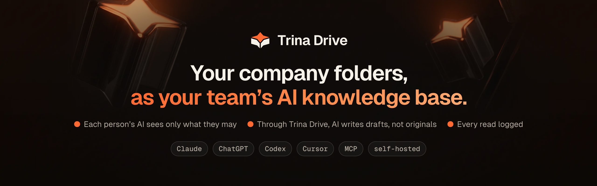
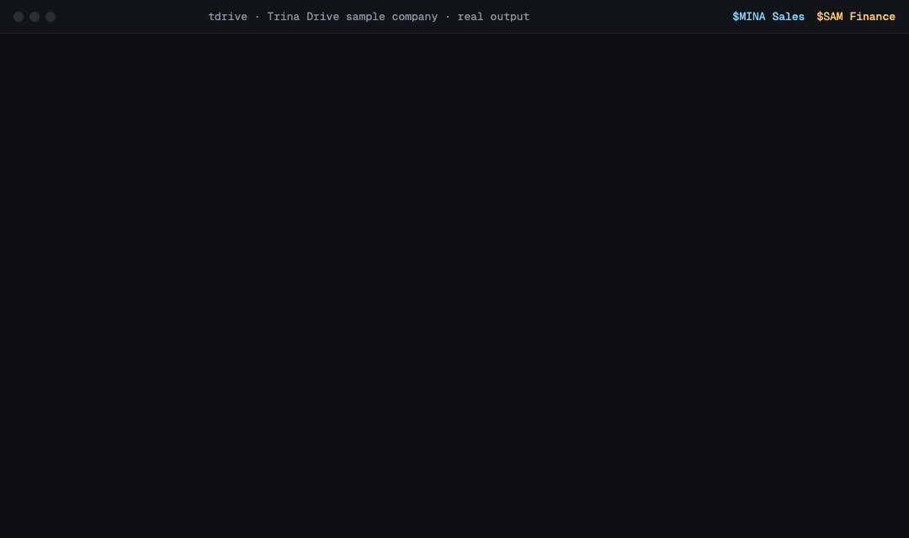
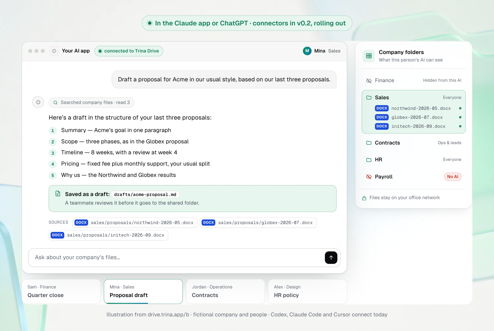
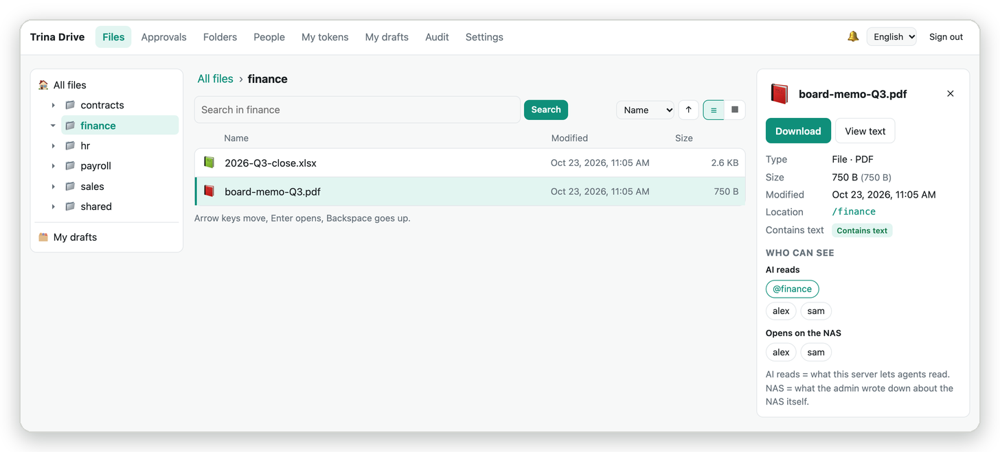
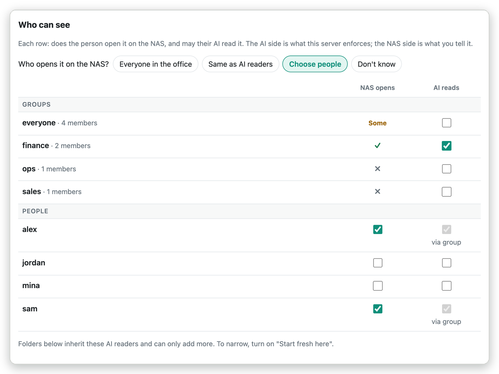
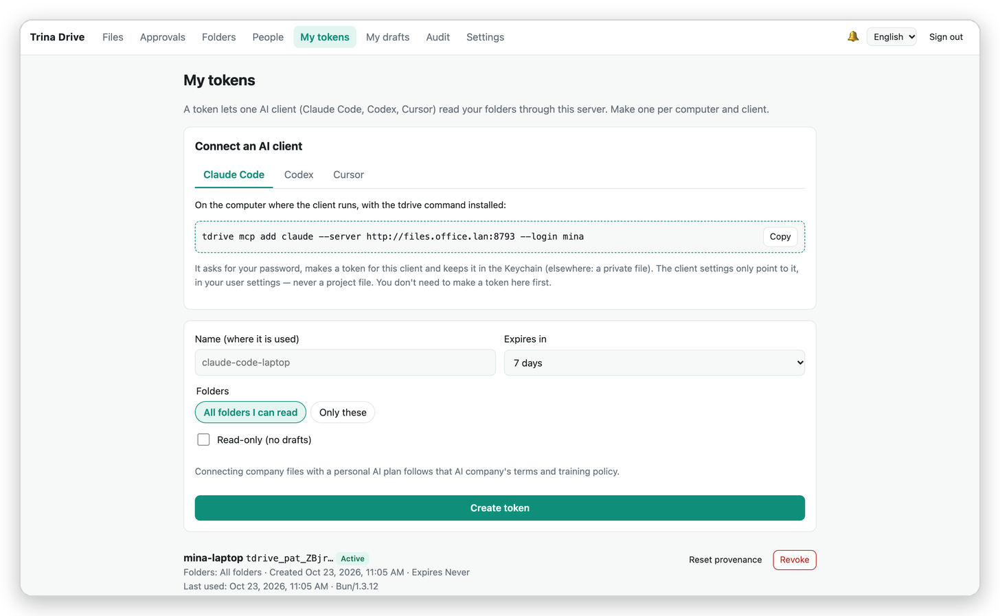
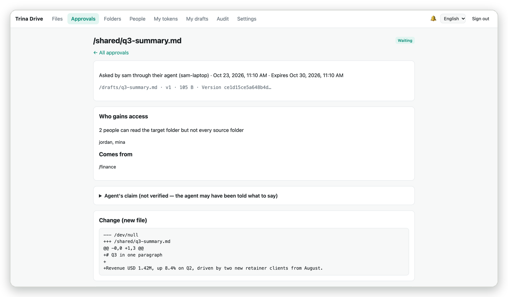
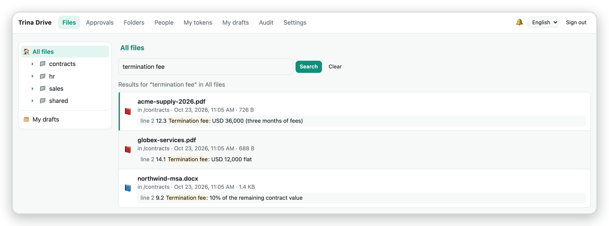
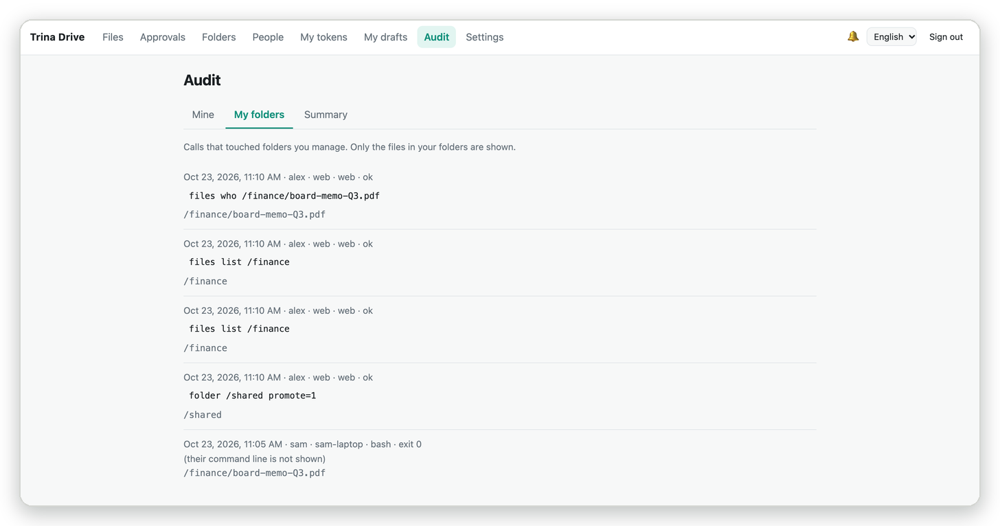
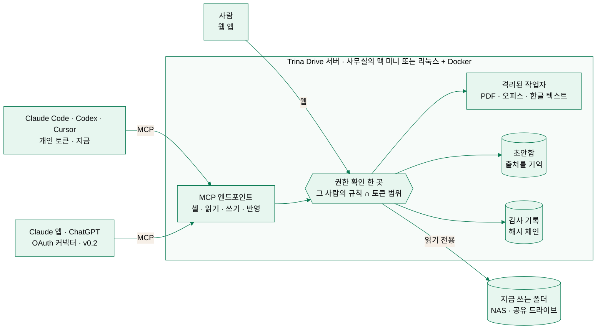

<p align="center">
  <a href="https://drive.trina.app"></a>
</p>

<p align="center">
  <a href="https://github.com/potenlab/trina-drive/stargazers"></a>
  <a href="https://github.com/potenlab/trina-drive/actions/workflows/ci.yml"></a>
  <a href="LICENSE"></a>
  <a href="#빠르게-시작하기"></a>
  <a href="CONTRIBUTING.md"></a>
  <a href="https://github.com/potenlab/trina-drive/discussions"></a>
</p>

<p align="center">
  <b>Claude, ChatGPT, Codex, Cursor에게 회사 파일을 물어보세요.</b><br>
  업로드도, RAG 파이프라인도, 온톨로지도 필요 없어요. 각자의 AI에는 그 사람이 볼 수 있는 파일만 보이고,<br>
  Trina Drive를 거친 AI는 원본이 아니라 초안에 쓰고, 읽은 파일은 모두 기록돼요. 5~20명 팀을 위해 만들었어요.
</p>

<p align="center">
  <a href="https://drive.trina.app"><b>웹사이트</b></a> ·
  <a href="docs/ARCHITECTURE.md"><b>문서</b></a> ·
  <a href="docs/SECURITY-MODEL.md"><b>보안 모델</b></a> ·
  <a href="https://github.com/potenlab/trina-drive/discussions"><b>Discussions</b></a> ·
  <a href="https://drive.trina.app/#pricing"><b>요금</b></a>
  <br><sub><a href="README.md">English</a></sub>
</p>

<p align="center">
  
</p>
<p align="center"><sub>예시 회사(<a href="docs/assets/src/seed.sh"><code>seed.sh</code></a>)에서 나온 실제 출력을 한 글자씩 재생했어요. Mina는 영업팀, Sam은 재무팀이에요.</sub></p>

## 왜 Trina Drive인가요

- 📁 **지금 있는 폴더가 곧 지식 베이스예요.** 쓰고 있는 NAS나 공유 드라이브를 연결하면, AI가 파일 안(PDF, 워드,
  엑셀, 파워포인트, 한글)까지 직접 찾아봐요. 늘 최신 파일 그대로예요. 올릴 것도, 다시 만들 임베딩도, 컨설팅도 없어요.
- 🔒 **각자의 AI에는 볼 수 있는 것만 보여요.** 폴더마다 누구의 AI가 읽을지 정해요. 볼 수 없는 폴더는 이름조차
  보이지 않아요. 토큰으로 더 좁힐 수도 있어요. 폴더 하나만, 읽기 전용으로, 7일 동안처럼요.
- 🧾 **팀 전체에 열어 줘도 괜찮아요.** Trina Drive를 거친 AI는 원본을 건드리지 않고 초안에만 써요. 초안에는 어느
  폴더에서 왔는지가 남고, 더 많은 사람이 보게 될 때는 사람이 먼저 승인해요. AI가 연 파일은 모두 해시 체인 감사
  기록에 남아요.

## 이런 걸 물어볼 수 있어요

다들 이미 쓰는 AI 앱에서 물어보면 되고, 답에는 근거가 된 파일이 함께 나와요.

| 누가 | 질문 |
|---|---|
| 대표 | *"3분기 결산을 파트너용으로 정리해 줘. 예산 대비 매출, 이익률, 현금, 그리고 세무사에게 물어볼 것까지."* |
| 운영 | *"해지 수수료가 1,000만 원 넘는 고객 계약은 어디고, 해지 통보 기간은 얼마야?"* |
| 영업 | *"지난 리테일 제안서 세 개와 단가표를 참고해서 루멘커피 제안서 초안 써 줘."* |
| 프로젝트 | *"내일 오크라인 미팅이야. 계약 범위, 그 뒤에 약속한 것, 아직 남은 일을 정리해 줘."* |
| 인사 | *"12월에 2주 동안 리스본에서 일하려고 해. 뭘 해야 하고, 코워킹 비용도 청구할 수 있어?"* |
| 재무 | *"인쇄 견적 세 개를 단가, 최소 수량, 납기, 결제 조건으로 비교해 줘."* |

<p align="center">
  
</p>

## 화면

<table>
  <tr>
    <td width="50%"><br><sub><b>파일.</b> 드라이브처럼 둘러보고, 파일마다 "누가 볼 수 있나"가 보여요.</sub></td>
    <td width="50%"><br><sub><b>폴더 규칙.</b> 누구의 AI가 읽을지, NAS에서 누가 여는지를 한 표에서 봐요.</sub></td>
  </tr>
  <tr>
    <td><br><sub><b>AI 연결.</b> 앱마다 명령 한 줄이면 돼요. 토큰은 범위·읽기 전용·만료를 정할 수 있어요.</sub></td>
    <td><br><sub><b>승인.</b> 더 많은 사람이 보게 될 초안은 변경 내용과 함께 사람을 기다려요.</sub></td>
  </tr>
  <tr>
    <td><br><sub><b>파일 안 검색.</b> Mina에게 보이는 그대로예요. 재무·급여 폴더는 없어요.</sub></td>
    <td><br><sub><b>감사 기록.</b> 폴더 관리자는 누가, 어떤 앱으로, 어떤 파일을 열었는지 봐요.</sub></td>
  </tr>
</table>

<sub>화면은 영어로 찍었어요. 웹 앱은 한국어도 지원해요.</sub>

## 빠르게 시작하기

**[관리형](#관리형-설치와-운영을-맡기기)** · **[맥 미니에 직접 설치](#맥-미니에-직접-설치)** · **[리눅스 Docker](#리눅스-docker)** · **[내 컴퓨터에서 데모](#2분-데모)**

### 관리형: 설치와 운영을 맡기기

사무실 맥 미니에 Trina Drive를 설치하고, 폴더와 팀의 AI 앱을 연결해 드려요. 업데이트, 백업, 모니터링까지 맡아요.
월 **$99**부터예요(원화 요금은 사이트에 있어요). 보안 기능은 직접 설치해도 모두 무료예요.

**[설치 상담 예약하기 →](mailto:contact@trina.app?subject=Trina%20Drive%20%EC%84%A4%EC%B9%98%20%EC%83%81%EB%8B%B4)** &nbsp;·&nbsp; [요금 보기](https://drive.trina.app/#pricing)

### 맥 미니에 직접 설치

v0.1의 설치 방법이에요. 설치기가 서비스 계정, LaunchDaemon, 고정 버전 도구, 암호화된 일일 백업까지 준비해요
([docs/INSTALL.md](docs/INSTALL.md), 영어).

```sh
bun scripts/build.ts                   # 릴리스 폴더 만들기 (서명된 릴리스는 곧 나와요)
cd dist/trina-drive-*-darwin-arm64
./install-macos.sh --dry-run           # 무엇을 할지 미리 보기
sudo ./install-macos.sh                # 설치. 웹 첫 설정 토큰이 한 번 출력돼요
```

### 리눅스 Docker

v0.2의 방법이에요. 컨테이너 하나로 돌고, 문서·셸 작업은 bubblewrap으로 격리돼요. NAS 공유 폴더는 읽기 전용으로
연결해요([docs/DOCKER.md](docs/DOCKER.md), 영어).

```sh
git clone https://github.com/potenlab/trina-drive && cd trina-drive
docker compose build
docker compose run --rm trina-drive init   # 웹 첫 설정 토큰 출력
docker compose up -d                       # 웹 앱과 MCP: 127.0.0.1:8787
```

### 2분 데모

[Bun](https://bun.sh) 1.3, ripgrep, poppler가 필요해요(`brew install ripgrep poppler`).

```sh
git clone https://github.com/potenlab/trina-drive && cd trina-drive
bun install && bun run build:web
alias tdrive="bun run $PWD/src/cli.ts --data $PWD/.trina-drive"
docs/assets/src/seed.sh .trina-drive     # GIF 속 예시 회사. MINA, SAM, SETUP 토큰이 출력돼요
tdrive serve                             # 웹 앱 http://127.0.0.1:8787/, MCP는 /mcp

tdrive sh --token <MINA 토큰> -c 'ls /'    # 다른 터미널에서 (같은 alias로)
```

웹 앱에 설정 토큰을 붙여 넣으면 관리자(`alex`)로 들어가요. 빈 데이터 폴더에서 `tdrive demo seed`를 실행하면
한국어 예시 회사가 만들어져요.

## AI 연결하기

각자 자기 컴퓨터에서 실행해요.

```sh
tdrive mcp add claude --server http://files.office.lan:8787 --login mina     # codex, cursor도 같아요
```

로그인해서 개인 토큰을 만들고, macOS 키체인(또는 0600 파일)에 넣고, 서버를 **사용자 설정**에만 등록해요.
저장소의 `.mcp.json`에는 절대 쓰지 않아요. `--scope`, `--read-only`, `--ttl`로 토큰을 좁힐 수 있어요.

| AI 앱 | 연결 방법 | 상태 |
|---|---|---|
| Claude Code | `tdrive mcp add claude` | ✅ 지금 |
| Codex (CLI, 앱) | `tdrive mcp add codex` | ✅ 지금 |
| Cursor | `tdrive mcp add cursor` | ✅ 지금 |
| Claude 앱, claude.ai | 커스텀 커넥터, Cloudflare 터널로 OAuth 2.1 ([안내](docs/CONNECT-CLAUDE-AI.md)) | 🚀 v0.2, 순차 제공 중 |
| ChatGPT | 개발자 모드 커넥터, OAuth 2.1 ([안내](docs/CONNECT-CHATGPT.md)) | 🚀 v0.2, 순차 제공 중 |
| HTTP로 MCP를 쓰는 모든 도구 | `POST /mcp`에 `Authorization: Bearer tdrive_pat_…` | ✅ |

## 동작 방식



셸, 파일 도구, 검색, 웹 앱까지 들어오는 길은 모두 같은 권한 확인을 거쳐요. 에이전트는 작은 셸(`ls`, `cat`,
`grep -r`, 파이프. [just-bash](https://github.com/vercel-labs/just-bash)와 ripgrep 기반)로 일하는데, 그 안에는
그 사람이 읽을 수 있는 파일만 있어요. 그림 파일: [docs/assets/architecture.svg](docs/assets/architecture.svg) ·
자세히: [docs/ARCHITECTURE.md](docs/ARCHITECTURE.md)

## 보안 모델

- **판단하는 곳은 한 곳.** 셸, 파일 도구, 검색, 웹 앱, 초안이 모두 같은 함수에 물어요. 토큰 범위도 그 안에서
  적용돼서, 범위 밖 이름은 새어 나가지 않아요.
- **숨긴 것은 없는 것과 같아요.** 출력, 오류 문구, 종료 코드까지 없는 경로와 똑같아요.
- **AI는 그 사람보다 넓게 볼 수 없어요.** 관리자와 폴더 관리자가 폴더마다 AI 규칙을 정하고, 토큰은 좁히기만 해요.
  "AI 연결 금지" 폴더는 어떤 에이전트도 못 읽어요.
- **애매하면 닫아요.** 링크, NAS 시스템 폴더, 비슷해 보이는 이름, 마지막 검사 이후 옮겨진 것은 판단할 때까지 닫혀
  있어요. OS 격리가 없으면 셸 명령과 문서 해석을 거절해요.
- **쓰기는 초안으로.** Trina Drive를 거친 에이전트는 원본을 쓰거나, 이름을 바꾸거나, 지울 수 없어요. 초안은 새
  파일로만 반영되고, 더 많은 사람이 보게 되면 사람이 패스키나 인증 앱으로 승인해요.
- **확인할 수 있는 감사 기록.** 해시 체인, 비밀 값 가림, 서버 밖으로 보내는 서명 기준점, `tdrive audit verify`.

약속하지 않는 것도 있어요. AI가 읽은 내용은 그 사람이 쓰는 AI 회사로 가고, Trina Drive 밖에서 만든 복사본(NAS를
직접 연 경우 등)은 추적하지 않아요. 전체 내용과 알려진 한계:
**[docs/SECURITY-MODEL.md](docs/SECURITY-MODEL.md)**. 취약점을 찾았다면 [SECURITY.md](SECURITY.md)를 봐 주세요.

## 다른 방법과 비교

| | Trina Drive | 드라이브·Box 커넥터 | 기업용 검색 (Glean, Dust) | 공유 폴더 동기화 + Claude Code |
|---|---|---|---|---|
| 파일은 지금 자리에 (NAS, 공유 드라이브) | ✅ | 그쪽 클라우드로 옮김 | 사본을 색인 | ✅ |
| 각자의 AI에 자기 파일만 | ✅ | ✅ | ✅ | ❌ 노트북 전체 |
| AI를 사람보다 좁게 (폴더, 읽기 전용, 만료) | ✅ | ❌ | 일부 | ❌ |
| 모든 파일 안을 한 번에 검색 | ✅ 텍스트 grep | 찾은 뒤 한 파일씩 읽음 | ✅ 검색 색인 | ✅ (PDF·한글 제외) |
| 원본 보호, AI는 초안에 | ✅ | ❌ | 읽기 전용 | ❌ |
| 팀이 보고 검증하는 감사 기록 | ✅ 해시 체인 | 엔터프라이즈 요금제 | 관리자만 | ❌ |
| 직접 설치, 소스는 GitHub에 | ✅ | ❌ | ❌ | ✅ 서버 없음 |
| 대상 | 5~20명 팀 | 구글·Box 쓰는 회사 | 큰 회사 | 개발자 한 명 |

2026년 10월 공개 문서 기준이에요. 틀린 부분이 있으면 [이슈](https://github.com/potenlab/trina-drive/issues)로 알려 주세요.

## 로드맵

- [x] **v0.1: 읽기 셸, 초안함, 감사 기록.** 지금 폴더 위의 사람별 권한, Claude Code·Codex·Cursor용 MCP,
  `tdrive mcp add`, 웹 관리, 알림, 암호화 백업이 있는 macOS 설치기.
- [x] **v0.2: 모든 AI, 승인을 거친 반영** (완성, 순차 제공 중). Claude 앱·claude.ai·ChatGPT용 OAuth 2.1 커넥터,
  패스키와 TOTP, 승인을 거친 초안 반영, 웹 파일 브라우저, 리눅스 Docker 이미지.
- [ ] **v0.3 (사용자와 함께 정해요):** 구글 드라이브 연결 · 스캔 PDF OCR · 의미 검색 · 웹에서 올리기 · OIDC 로그인 ·
  더 많은 파일 형식. 필요한 것을 [Discussions](https://github.com/potenlab/trina-drive/discussions/categories/ideas)에 남겨 주세요.

## 자주 묻는 질문

<details>
<summary><b>파일이 사무실 밖으로 나가나요?</b></summary>

파일은 서버에 그대로 있고, 그 자리에서 읽어요. 다만 AI가 답하려고 읽은 내용은 그 사람이 쓰는 AI 회사(Anthropic,
OpenAI, Cursor)로 가고, 그 회사의 약관을 따라요. 절대 나가면 안 되는 폴더는 **AI 연결 금지**로 표시하세요. 사람은
웹 앱에서 계속 열 수 있고, 에이전트는 못 열어요.
</details>

<details>
<summary><b>파일을 올리거나 지식 베이스를 먼저 만들어야 하나요?</b></summary>

아니요. 지금 있는 폴더를 연결하면 돼요. AI가 문서 안(PDF, 워드, 엑셀, 파워포인트, 한글의 텍스트)을 직접 찾고,
필요한 파일을 동료처럼 열어 봐요. 새 파일은 저장하는 순간부터 보여요. 다시 만들 임베딩은 없고, 의미 검색은 추가
기능으로 로드맵에 있어요.
</details>

<details>
<summary><b>지금 어떤 AI 앱을 쓸 수 있나요?</b></summary>

Claude Code, Codex(CLI, 앱), Cursor는 개인 토큰으로 지금 연결돼요. Claude 앱, claude.ai, ChatGPT는 v0.2 커스텀
커넥터로 연결되고, 완성되어 순차 제공 중이에요. HTTP로 MCP를 쓰는 도구라면 무엇이든 붙어요.
</details>

<details>
<summary><b>AI가 우리 파일을 바꾸거나 지울 수 있나요?</b></summary>

Trina Drive를 거쳐서는 못 해요. 에이전트는 자기 초안함에만 쓰고, 초안에는 어느 폴더에서 왔는지가 남아요. 초안은
관리자가 열어 둔 폴더에 새 파일로만 반영되고, 더 많은 사람이 보게 되면 출처를 읽을 수 있는 사람이 먼저 승인해요.
NAS를 직접 여는 경우는 Trina Drive가 막을 수 없어요.
</details>

<details>
<summary><b>무료인가요? 라이선스는요?</b></summary>

직접 설치하면 보안 기능까지 모두 무료예요. 대신 운영을 맡기면 비용을 받아요(월 $99부터,
[요금](https://drive.trina.app/#pricing)). 프로젝트 전체가 Apache-2.0 오픈소스예요. [라이선스](#라이선스)를 봐 주세요.
</details>

## 기여하기

이슈와 PR 모두 환영해요. [CONTRIBUTING.md](CONTRIBUTING.md)(개발 환경, 테스트, 좋은 PR)와
[good first issue](https://github.com/potenlab/trina-drive/issues?q=is%3Aissue+is%3Aopen+label%3A%22good+first+issue%22)부터
보세요. 기여는 Apache-2.0으로 받고, 커밋에 DCO 서명(`git commit -s`)을 붙여 주세요. [행동 강령](CODE_OF_CONDUCT.md)을
지켜 주세요.

## 커뮤니티

- 💬 [GitHub Discussions](https://github.com/potenlab/trina-drive/discussions): 질문, 아이디어, 사용 사례
- 🐛 [Issues](https://github.com/potenlab/trina-drive/issues): 버그와 기능 요청
- 🔐 보안 제보: [SECURITY.md](SECURITY.md) (공개 이슈로 올리지 말아 주세요)
- ✉️ 설치·관리형 문의: [contact@trina.app](mailto:contact@trina.app)

## 라이선스

Apache-2.0 — [LICENSE](LICENSE)를 봐 주세요. 서버, CLI, 웹 앱, 웹사이트까지 저장소 전체에 적용돼요. Copyright 2026
Trina Inc. 필수 고지는 [NOTICE](NOTICE)에, 서드파티 구성 요소와 라이선스는
[docs/THIRD-PARTY.md](docs/THIRD-PARTY.md)에 있어요. "Trina"와 "Trina Drive"는 주식회사 트리나의 상표이고 Apache-2.0으로
허락되지 않아요.

## 스타 추이

<a href="https://star-history.com/#potenlab/trina-drive&Date">
  <picture>
    <source media="(prefers-color-scheme: dark)" srcset="https://api.star-history.com/svg?repos=potenlab/trina-drive&type=Date&theme=dark">
    <source media="(prefers-color-scheme: light)" srcset="https://api.star-history.com/svg?repos=potenlab/trina-drive&type=Date">
    
  </picture>
</a>

## 기여자

<a href="https://github.com/potenlab/trina-drive/graphs/contributors">
  
</a>

---

<p align="center">
  <sub>만든 곳: <a href="https://drive.trina.app">주식회사 트리나</a> (Trina Inc.) · <a href="mailto:contact@trina.app">contact@trina.app</a><br>
  Claude는 Anthropic, ChatGPT와 Codex는 OpenAI, Cursor는 Anysphere의 상표예요. Trina Drive는 이 회사들과 관계가 없어요.</sub>
</p>
