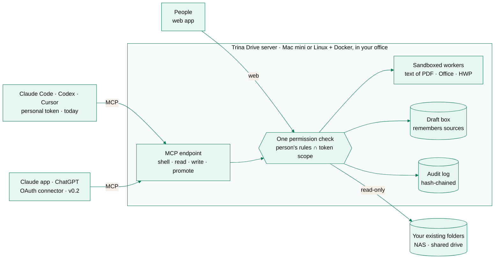

<p align="center">
  <a href="https://drive.trina.app"></a>
</p>

<p align="center">
  <a href="https://github.com/potenlab/trina-drive/stargazers"></a>
  <a href="https://github.com/potenlab/trina-drive/actions/workflows/ci.yml"></a>
  <a href="LICENSE"></a>
  <a href="#quickstart"></a>
  <a href="CONTRIBUTING.md"></a>
  <a href="https://github.com/potenlab/trina-drive/discussions"></a>
</p>

<p align="center">
  <b>Ask Claude, ChatGPT, Codex or Cursor about your company's files.</b><br>
  No uploads, no RAG pipeline, no ontology. Each person's AI sees only what they may,<br>
  through Trina Drive AI writes drafts (not originals), and every read is logged. Built for teams of 5 to 20.
</p>

<p align="center">
  <a href="https://drive.trina.app"><b>Website</b></a> ·
  <a href="docs/ARCHITECTURE.md"><b>Docs</b></a> ·
  <a href="docs/SECURITY-MODEL.md"><b>Security model</b></a> ·
  <a href="https://github.com/potenlab/trina-drive/discussions"><b>Discussions</b></a> ·
  <a href="https://drive.trina.app/#pricing"><b>Pricing</b></a>
  <br><sub><a href="README.ko.md">한국어</a></sub>
</p>

<p align="center">
  
</p>
<p align="center"><sub>Real output from a sample company (<a href="docs/assets/src/seed.sh"><code>seed.sh</code></a>), typed out frame by frame. Mina is in Sales, Sam is in Finance.</sub></p>

## Why Trina Drive

- 📁 **Your folders already are the knowledge base.** Point Trina Drive at the NAS or shared drive you have. Your AI
  searches inside the files themselves (PDF, Word, Excel, PowerPoint, HWP), always the current version. Nothing to
  upload, no embeddings to rebuild, no consultants.
- 🔒 **Each person's AI sees only what they may.** Choose, folder by folder, whose AI may read it. A folder you may not
  read doesn't show up at all, not even its name. Tokens can narrow it further: one folder, read-only, seven days.
- 🧾 **Safe to hand to the whole team.** Through Trina Drive, AI writes drafts, never your originals; each draft
  remembers which folders it came from, and a person approves before it reaches a wider audience. Every file an AI
  opens lands in a hash-chained audit log.

## What you can ask

Everyone asks in the AI app they already use, and every answer names the files it came from.

| who | ask |
|---|---|
| Founder | *"Summarize Q3's close for the partners: revenue, margin and cash against budget, and what to ask our accountant."* |
| Operations | *"Which client contracts have a termination fee above $10k, and what's the notice period?"* |
| Sales | *"Draft a proposal for Lumen Coffee modeled on our last three retail proposals and our rate card."* |
| Projects | *"I have a call with Oakline tomorrow. What's in our signed scope, what have we promised since, and what's still open?"* |
| HR & People | *"I'm working from Lisbon for two weeks in December. What do I need to do, and can I expense a coworking space?"* |
| Finance | *"Compare the three print quotes: unit price, minimum order, lead time and payment terms."* |

<p align="center">
  
</p>

## Screenshots

<table>
  <tr>
    <td width="50%"><br><sub><b>Files.</b> A Drive-like browser for people, with "who can see" on every file.</sub></td>
    <td width="50%"><br><sub><b>Folder rules.</b> Whose AI may read a folder, next to who opens it on the NAS.</sub></td>
  </tr>
  <tr>
    <td><br><sub><b>Connect your AI.</b> One command per app; tokens can be scoped, read-only and short-lived.</sub></td>
    <td><br><sub><b>Approvals.</b> A draft that would reach more people waits for a person, with the diff.</sub></td>
  </tr>
  <tr>
    <td><br><sub><b>Search inside files</b>, as Mina sees them: no Finance or Payroll folders.</sub></td>
    <td><br><sub><b>Audit.</b> Folder managers see which person, which app and which file.</sub></td>
  </tr>
</table>

## Quickstart

**[Managed](#managed-we-set-it-up)** · **[Self-host on a Mac mini](#self-host-on-a-mac-mini)** · **[Docker on Linux](#docker-on-linux)** · **[Try the demo locally](#try-the-demo-in-two-minutes)**

### Managed (we set it up)

We install and run Trina Drive on a Mac mini in your office, connect your folders and your team's AI apps, and keep it
updated, backed up and monitored. From **$99/month**; every security feature is also free to self-host.

**[Book a setup call →](mailto:contact@trina.app?subject=Trina%20Drive%20setup%20call)** &nbsp;·&nbsp; [See plans](https://drive.trina.app/#pricing)

### Managed storage: Trina Cloud

No NAS? Let Trina Drive own the folders. In **managed storage** your team uploads, renames, moves and deletes files in
the web app (drag and drop, folders, large files, version history, trash), with the same per-person rules and the same
audit, and agents read it exactly like a NAS folder. We host it per team in Trina Cloud, or run it yourself:
`tdrive init --managed`, then make team folders on the Folders page (or `tdrive folder create <name>`). Details:
[docs/ARCHITECTURE.md](docs/ARCHITECTURE.md#managed-storage-cloud-mode).

### Self-host on a Mac mini

The v0.1 path: a release folder and an installer that sets up service accounts, LaunchDaemons, pinned tools and
encrypted daily backups ([docs/INSTALL.md](docs/INSTALL.md)).

```sh
bun scripts/build.ts                   # builds the release folder (signed releases are coming)
cd dist/trina-drive-*-darwin-arm64
./install-macos.sh --dry-run           # see what it would do
sudo ./install-macos.sh                # install; prints the one-time web setup token
```

### Docker on Linux

v0.2: one container, document and shell workers isolated with bubblewrap. NAS shares are mounted read-only
([docs/DOCKER.md](docs/DOCKER.md)).

```sh
git clone https://github.com/potenlab/trina-drive && cd trina-drive
docker compose build
docker compose run --rm trina-drive init   # prints the one-time web setup token
docker compose up -d                       # web app and MCP on 127.0.0.1:8787
```

### Try the demo in two minutes

Needs [Bun](https://bun.sh) 1.3, ripgrep and poppler (`brew install ripgrep poppler`, or your distro's packages).

```sh
git clone https://github.com/potenlab/trina-drive && cd trina-drive
bun install && bun run build:web
alias tdrive="bun run $PWD/src/cli.ts --data $PWD/.trina-drive"
docs/assets/src/seed.sh .trina-drive     # the sample company from the GIF; prints MINA, SAM and SETUP tokens
tdrive serve                             # web app at http://127.0.0.1:8787/, MCP at /mcp

tdrive sh --token <MINA token> -c 'ls /'   # in another terminal (with the same alias)
```

Open the web app and paste the setup token to sign in as the admin (`alex`). `tdrive demo seed` on an empty data directory gives a Korean
sample company instead.

## Connect your AI

On each person's own computer:

```sh
tdrive mcp add claude --server http://files.office.lan:8787 --login mina     # or: codex, cursor
```

It signs in, makes a personal token, keeps it in the macOS Keychain (or a 0600 file) and registers the server in your
**user** settings, never in a repository's `.mcp.json`. `--scope`, `--read-only` and `--ttl` narrow the token.

| AI app | how it connects | status |
|---|---|---|
| Claude Code | `tdrive mcp add claude` | ✅ today |
| Codex (CLI and app) | `tdrive mcp add codex` | ✅ today |
| Cursor | `tdrive mcp add cursor` | ✅ today |
| Claude app and claude.ai | custom connector, OAuth 2.1 through a Cloudflare tunnel ([guide](docs/CONNECT-CLAUDE-AI.md)) | 🚀 v0.2, rolling out |
| ChatGPT | developer-mode connector, OAuth 2.1 ([guide](docs/CONNECT-CHATGPT.md)) | 🚀 v0.2, rolling out |
| anything that speaks MCP over HTTP | `Authorization: Bearer tdrive_pat_…` on `POST /mcp` | ✅ |

More: [docs/CONNECT-CLIENTS.md](docs/CONNECT-CLIENTS.md).

## How it works



Every way in (the shell, file tools, search, the web app) asks the same permission check. Agents get a small shell
(`ls`, `cat`, `grep -r`, pipes; built on [just-bash](https://github.com/vercel-labs/just-bash), with ripgrep) over a
virtual tree that holds only what that person may read. Static diagram: [docs/assets/architecture.svg](docs/assets/architecture.svg).
Details: [docs/ARCHITECTURE.md](docs/ARCHITECTURE.md).

## Security model

- **One decision point.** Shell, file tools, search, the web app and drafts all ask the same function; the token's
  scope is applied inside it, so names outside the scope never leak.
- **Hidden means nonexistent.** Same output, error text and exit code as a path that does not exist.
- **An agent never exceeds its person.** Admins and folder managers set AI rules per folder; a token can only narrow them.
  "No AI" folders are closed to every agent.
- **Fail closed.** Links, NAS system folders, look-alike names and anything moved since the last scan stay closed
  until judged. Without OS isolation, shell commands and document parsing are refused.
- **Writes are drafts.** Through Trina Drive, agents cannot write, rename or delete originals. Promoting a draft
  creates a new file; if more people would see it, a person approves with a passkey or authenticator app.
- **Audit you can check.** Hash chain, secrets redacted, signed anchors sent off the server, `tdrive audit verify`.

What we do *not* promise: what an AI reads goes to the AI company its person uses, and copies made outside Trina Drive
(someone opening the NAS directly) aren't tracked. The full picture and known limits:
**[docs/SECURITY-MODEL.md](docs/SECURITY-MODEL.md)**. Found a vulnerability? [SECURITY.md](SECURITY.md).

## How it compares

| | Trina Drive | Drive / Box connector | Enterprise search (Glean, Dust) | Sync the share + Claude Code |
|---|---|---|---|---|
| Files stay where they are (NAS, shared drive) | ✅ | move to their cloud | indexes copies | ✅ |
| Each person's AI sees only their files | ✅ | ✅ | ✅ | ❌ whole laptop |
| AI narrower than its person (folder, read-only, expiry) | ✅ | ❌ | partial | ❌ |
| Search inside every file at once | ✅ grep over text | finds, then reads files one at a time | ✅ search index | ✅ (not PDF/HWP) |
| Originals protected, AI writes drafts | ✅ | ❌ | read-only | ❌ |
| Audit the team can see and verify | ✅ hash-chained | enterprise plans | admin only | ❌ |
| Self-hosted, source on GitHub | ✅ | ❌ | ❌ | ✅ no server |
| Made for | teams of 5–20 | Google / Box shops | large companies | one developer |

Based on public documentation as of October 2026. Something out of date? [Open an issue](https://github.com/potenlab/trina-drive/issues).

## Roadmap

- [x] **v0.1: read shell, draft box, audit.** Per-person permissions over existing folders, MCP for Claude Code, Codex
  and Cursor, `tdrive mcp add`, web admin, alerts, macOS installer with encrypted backups.
- [x] **v0.2: any AI, approved promotion** (built, rolling out). OAuth 2.1 connectors for the Claude app, claude.ai
  and ChatGPT; passkeys and TOTP; draft promotion with approvals; web file browser; Linux Docker image.
- [x] **Managed storage** (built): the server owns the team folders; upload, folders, rename, move, trash, versions and
  quota from the web app; promote may overwrite there as a new version.
- [ ] **v0.3 (shaped with users):** Google Drive as a source · OCR for scanned PDFs · semantic search · WebDAV ·
  OIDC sign-in · more extractors. Tell us what you need in
  [Discussions](https://github.com/potenlab/trina-drive/discussions/categories/ideas).

## FAQ

<details>
<summary><b>Do our files leave the office?</b></summary>

The files stay on your server and are read in place. What an AI reads to answer a question goes to the AI company
that person uses (Anthropic, OpenAI, Cursor), under that company's terms. Mark folders that must never leave as
**No AI**: people can still open them in the web app, no agent can.
</details>

<details>
<summary><b>Do we need to upload files or build a knowledge base first?</b></summary>

No. Point Trina Drive at the folders you already have. The AI searches inside the documents themselves (the text of
PDF, Word, Excel, PowerPoint and HWP files) and reads the ones it needs, the way a colleague would. New files are
there as soon as they're saved. There are no embeddings to rebuild; semantic search is on the roadmap as an addition.
</details>

<details>
<summary><b>Which AI apps work today?</b></summary>

Claude Code, Codex (CLI and app) and Cursor connect today with a personal token. The Claude app, claude.ai and ChatGPT
connect as custom connectors in v0.2, which is built and rolling out. Anything that speaks MCP over HTTP works too.
</details>

<details>
<summary><b>Can the AI change or delete our files?</b></summary>

Not through Trina Drive. Agents write only to their own draft box, and each draft remembers which folders it came
from. A draft reaches a team folder only as a new file, in folders an admin has opened for it; if that would let more
people see it, someone who can read the sources approves it first. Someone opening the NAS directly is outside Trina
Drive's control.
</details>

<details>
<summary><b>Is it free? What's the license?</b></summary>

Self-hosting is free, with every security feature. We charge for running it for you (from $99/month,
[pricing](https://drive.trina.app/#pricing)). The whole project is open source under Apache-2.0; see [License](#license).
</details>

## Contributing

Issues and pull requests are welcome. Start with [CONTRIBUTING.md](CONTRIBUTING.md) (setup, tests, what a good PR
looks like) and the [good first issues](https://github.com/potenlab/trina-drive/issues?q=is%3Aissue+is%3Aopen+label%3A%22good+first+issue%22).
Contributions are accepted under Apache-2.0 with a DCO sign-off (`git commit -s`). Please follow the
[Code of Conduct](CODE_OF_CONDUCT.md).

## Community

- 💬 [GitHub Discussions](https://github.com/potenlab/trina-drive/discussions): questions, ideas, show and tell
- 🐛 [Issues](https://github.com/potenlab/trina-drive/issues): bugs and feature requests
- 🔐 Security reports: [SECURITY.md](SECURITY.md) (please don't open a public issue)
- ✉️ [contact@trina.app](mailto:contact@trina.app) for setup and managed plans

## License

Apache-2.0 — see [LICENSE](LICENSE). This covers the whole repository: server, CLI, web app and website. Copyright
2026 Trina Inc.; required notices are in [NOTICE](NOTICE), and third-party components and their licenses are listed in
[docs/THIRD-PARTY.md](docs/THIRD-PARTY.md). "Trina" and "Trina Drive" are trademarks of Trina Inc. and are not
licensed by Apache-2.0.

## Star history

<a href="https://star-history.com/#potenlab/trina-drive&Date">
  <picture>
    <source media="(prefers-color-scheme: dark)" srcset="https://api.star-history.com/svg?repos=potenlab/trina-drive&type=Date&theme=dark">
    <source media="(prefers-color-scheme: light)" srcset="https://api.star-history.com/svg?repos=potenlab/trina-drive&type=Date">
    
  </picture>
</a>

## Contributors

<a href="https://github.com/potenlab/trina-drive/graphs/contributors">
  
</a>

---

<p align="center">
  <sub>Made by <a href="https://drive.trina.app">Trina Inc.</a> (주식회사 트리나) · <a href="mailto:contact@trina.app">contact@trina.app</a><br>
  Claude is a trademark of Anthropic; ChatGPT and Codex are trademarks of OpenAI; Cursor is a trademark of Anysphere. Trina Drive is not affiliated with them.</sub>
</p>
