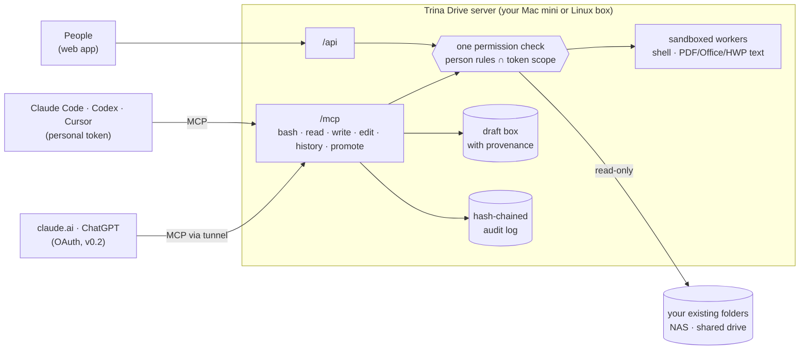

<p align="center">
  <a href="https://drive.trina.app"></a>
</p>

<h1 align="center">Trina Drive</h1>

<p align="center">
  <b>Give your team's AI agents your company files.</b><br>
  They only see what each person is allowed to, never touch originals, and everything is logged.
</p>

<p align="center">
  <a href="#license"></a>
  <a href="https://github.com/potenlab/trina-drive/actions/workflows/ci.yml"></a>
  <a href="docs/DOCKER.md"></a>
  
  
</p>

<p align="center">
  <a href="https://drive.trina.app">Website</a> ·
  <a href="#quickstart">Quickstart</a> ·
  <a href="docs/ARCHITECTURE.md">Docs</a> ·
  <a href="docs/SECURITY-MODEL.md">Security model</a> ·
  <a href="https://drive.trina.app/#pricing">Pricing</a> ·
  <a href="README.ko.md">한국어</a>
</p>

---

Trina Drive is an **open-source, self-hosted, permission-aware team file server for AI agents**. Point it at the
folders your team already has (a NAS share, a shared drive on an office Mac) and connect Claude Code, Codex, Cursor,
claude.ai or ChatGPT over MCP. Each agent gets a real shell (`ls`, `grep -r`, `cat`, pipes) over a virtual tree that
holds **only what its person may read**, narrowed further by its token. Originals are read-only; agents write to their
own draft box. Every call lands in a hash-chained audit log.

<!-- TODO(launch): record a 20-second demo (kim and boss asking the same question in Claude Code) as
     docs/assets/demo.gif (≤ 5 MB, 1200 px wide) and uncomment the line below.
<p align="center"></p>
-->

Same server, same question, two people. `kim` is on the project team; `boss` runs the company:

```console
$ tdrive sh --token $KIM -c 'ls /'                    # kim's agent: no 경영 (management) folder at all
drafts
개인_kim
공용
프로젝트

$ tdrive sh --token $KIM -c 'grep -rl 매출 /'          # "revenue": no matches kim may see (exit 1)

$ tdrive sh --token $KIM -c 'ls /경영'
ls: /경영: No such file or directory                  # hidden looks exactly like missing
$ tdrive sh --token $KIM -c 'ls /없는폴더'
ls: /없는폴더: No such file or directory

$ tdrive sh --token $KIM -c 'echo hi > /프로젝트/README.md'
bash: /프로젝트/README.md: Originals are read-only. Write to /drafts/ and a person will move it.

$ tdrive sh --token $KIM -c 'grep -c 견적 /프로젝트/*.md > /drafts/견적_요약.md && ls /drafts'
견적_요약.md                                          # drafts remember which folders they came from

$ tdrive sh --token $BOSS -c 'grep -r 매출 /'
/경영/손익_요약.xlsx:매출	1240000000                   # text inside xlsx, docx, pdf, hwp(x) is greppable
/경영/손익.csv:매출,1240000000

$ tdrive audit verify
audit chain ok: 6 rows, head 1539812405509ecb…
```

Real output from the `tdrive demo seed` sample company, comments added ([try it](#try-it-in-two-minutes)).

## Why

AI agents are at their best with files and a shell. They are also at their most dangerous there: private data,
untrusted content and a way to send things out add up to what Simon Willison calls the
[lethal trifecta](https://simonwillison.net/2025/Jun/16/the-lethal-trifecta/). Today a small team picks one of:

- **Sync the shared drive to every laptop and run Claude Code on it.** A real shell, free, and every agent sees
  everything its person's laptop has. Nobody knows what it read. HWP and PDF contents are invisible to `grep`.
- **A cloud drive's MCP connector** (Google Drive, Box). Move everything into their cloud first; no shell; agent
  controls live in the top enterprise tier.
- **Enterprise search** (Glean, Dust). Built for large companies and SaaS sources, priced per seat, not your NAS.
- **Your NAS vendor's MCP** (QNAP MCP Assistant). Gives the AI one NAS account; not per person, no draft box, no
  provenance.

Trina Drive keeps your files where they are and puts **one permission check and one audit log** in front of every way
an agent can reach them: the shell, the file tools, search, and the web.

## Features

- 🔒 **Per-person agent permissions.** Agent view = the person's AI rules ∩ the token's scope. Give an intern's Claude
  Code "this project folder, read-only, for 7 days".
- 👻 **Hidden means nonexistent.** Same output, error text and exit code as a path that does not exist. No folder
  names, sizes or counts leak.
- 🐚 **A real shell for agents.** `ls`, `find`, `grep -r`, `sed`, `awk`, `wc`, pipes, over a virtual tree
  ([just-bash](https://github.com/vercel-labs/just-bash)); `grep` is ripgrep.
- 📄 **Search inside documents.** PDF, DOCX, XLSX, PPTX, HWP and HWPX are read as text, in sandboxed workers.
- ✍️ **Originals stay untouched.** Agents write to `/drafts/`; each draft carries the folders it was derived from.
  Promoting a draft into a wider folder needs a person with a passkey (v0.2).
- 🧾 **Everything is logged.** Hash-chained audit of every call, signed anchors sent off the server, alerts for bulk
  reads, new clients and write attempts, one-click revoke.
- 🖥️ **Web app for people.** Folders, rules, tokens, approvals, audit, and a read-only file browser (English and Korean).
- 🔌 **Any MCP client.** Claude Code, Codex and Cursor with personal tokens; claude.ai and ChatGPT with OAuth (v0.2).

## How it works



More: [docs/ARCHITECTURE.md](docs/ARCHITECTURE.md).

## Quickstart

### Try it in two minutes

Needs [Bun](https://bun.sh) 1.3, ripgrep and poppler (`brew install ripgrep poppler`, or your distro's packages).

```sh
git clone https://github.com/potenlab/trina-drive && cd trina-drive
bun install && bun run build:web
alias tdrive="bun run $PWD/src/cli.ts"

tdrive --data ./.trina-drive demo seed     # sample company, people, rules; prints tokens for kim and boss
tdrive --data ./.trina-drive serve         # web app at http://127.0.0.1:8787/, MCP at /mcp
```

In another terminal, run the demo above with `tdrive --data ./.trina-drive sh --token <kim token> -c 'ls /'`.

### Install for a team

| | how | guide |
|---|---|---|
| **macOS** (an office Mac mini, v0.1) | `sudo ./install-macos.sh` from a release folder: service accounts, LaunchDaemons, pinned tools, encrypted daily backups | [docs/INSTALL.md](docs/INSTALL.md) |
| **Linux + Docker** (v0.2) | `docker compose run --rm trina-drive init && docker compose up -d`; workers isolated with bubblewrap | [docs/DOCKER.md](docs/DOCKER.md) |

Releases and a published image arrive with the public launch; until then build them from source
(`bun scripts/build.ts`, `docker compose build`).

### Connect your agent

On each person's own computer:

```sh
tdrive mcp add claude --server http://files.office.lan:8787 --login kim
```

It signs in, makes a personal token, keeps it in the macOS Keychain (or a 0600 file), and registers the server in
**user scope** only, never in a repo's `.mcp.json`. `codex` and `cursor` work the same way; `--scope`, `--read-only`
and `--ttl` narrow the token. Details: [docs/CONNECT-CLIENTS.md](docs/CONNECT-CLIENTS.md).

## Supported clients

| client | how it connects | status |
|---|---|---|
| Claude Code | `tdrive mcp add claude` (personal token via `headersHelper`) | ✓ v0.1 |
| Codex | `tdrive mcp add codex` (`bearer_token_env_var`) | ✓ v0.1 |
| Cursor | `tdrive mcp add cursor` (`${env:…}` header) | ✓ v0.1 |
| claude.ai (custom connector) | OAuth 2.1 + public address through a Cloudflare tunnel | ✓ v0.2 · [guide](docs/CONNECT-CLAUDE-AI.md) |
| ChatGPT (developer mode connector) | OAuth 2.1, same public address | ✓ v0.2 · [guide](docs/CONNECT-CHATGPT.md) |
| Anything else that speaks MCP over HTTP | `Authorization: Bearer tdrive_pat_…` on `POST /mcp` | ✓ |

## Security model

- **One decision point.** Shell, file tools, search, web downloads and drafts all ask the same function. The token's
  scope is computed inside it, so names outside the scope never leak.
- **Agents never exceed their person.** Agent rules are set per folder by admins and folder managers; a token can only
  narrow them.
- **Fail closed.** Links, hard links, NAS system folders, Unicode look-alike names and anything moved since the last
  scan are closed until judged. Without OS isolation, shell commands and document parsing are refused.
- **Writes are drafts.** Agents cannot write, rename or delete originals through Trina Drive. Promotions create new
  files; widening ones wait for a passkey approval that a browser agent cannot fake.
- **Audit you can check.** Hash chain, secrets redacted, signed anchors mailed off the server, `tdrive audit verify`.

What we do *not* promise: that data never leaves (what an agent reads goes to the AI provider its person chose), or
that copies made outside Trina Drive are caught. The full picture, including known limits:
**[docs/SECURITY-MODEL.md](docs/SECURITY-MODEL.md)**. Found a vulnerability? See [SECURITY.md](SECURITY.md).

## How it compares

| | Trina Drive | Google Drive / Box MCP | Glean / Dust | QNAP MCP Assistant | Sync folder + Claude Code |
|---|---|---|---|---|---|
| Open source, on your hardware | ✓ | ✗ | ✗ | on the NAS, closed | ✓ (no server) |
| Works on your existing folders in place | ✓ any share | move to their cloud | indexes copies | ✓ its own NAS | ✓ |
| Each person's agent sees only their files | ✓ | ✓ | ✓ | one NAS account per key | ✗ whole laptop |
| Agent narrower than its person (scope, read-only, expiry) | ✓ | ✗ | partial | read-only switch | ✗ |
| Real shell (`ls`, `grep -r`, pipes) | ✓ | ✗ | ✗ | ✗ | ✓ |
| `grep` inside PDF / Office / HWP | ✓ | search index | search index | keyword search | ✗ |
| Originals protected, agent writes go to drafts | ✓ | ✗ | read-only | read-only switch | ✗ |
| Widening writes need a human approval | ✓ passkey | top tier (Box) | ✗ | ✗ | ✗ |
| Audit log the team can see and verify | ✓ hash-chained | enterprise plans | admin only | — | ✗ |
| Claude Code, Codex, Cursor, claude.ai, ChatGPT | ✓ | ✓ | own app first | MCP clients | Claude Code |

Based on public documentation as of October 2026. Something out of date? Please open an issue.

## Pricing

**Self-hosted Trina Drive is free forever, with every security feature.** We charge for running it for you.

| | price | what |
|---|---|---|
| **Community** | $0 | The full product on your hardware. Community support on GitHub. |
| **Team** (managed) | $99 / month | We install, monitor, update, back up and secure it on your office Mac mini. Up to 10 AI-connected people, unlimited file-only people. |
| **Business** (managed) | $349 / month | Up to 40 AI-connected people, faster response, quarterly permission and audit review. |
| **Setup & migration** | from $1,490 | Folder and permission design, NAS / Mac mini setup, client training. |

Details and Korean won prices: **[drive.trina.app/#pricing](https://drive.trina.app/#pricing)**.

## Roadmap

- [x] **v0.1: read shell, draft box, audit.** Per-person permissions over existing folders, MCP for Claude Code /
  Codex / Cursor, `tdrive mcp add`, web admin, alerts, macOS installer with encrypted backups.
- [x] **v0.2: any AI, approved promotion.** OAuth 2.1 for claude.ai and ChatGPT, public listener behind a tunnel,
  passkeys and TOTP, draft promotion with approvals, read-only web file browser, Linux Docker image.
- [ ] Security gate and public beta (in progress).
- [ ] **v0.3 (to be decided with users):** overwrite-in-place promotion, file previews on a separate origin, OIDC
  sign-in (Google, Microsoft), OCR, semantic search, a permission-aware document graph, KakaoTalk notifications,
  S3-compatible backup targets, managed mode with its own data folder.

## Documentation

| | |
|---|---|
| [ARCHITECTURE.md](docs/ARCHITECTURE.md) | components, MCP tools, web API, promotion, reconciler, dependencies |
| [SECURITY-MODEL.md](docs/SECURITY-MODEL.md) | threat model, permission rules R0–R11, audit, second factors, OAuth, known limits |
| [CONFIG.md](docs/CONFIG.md) | names, environment variables, data directory, command reference |
| [CONNECT-CLIENTS.md](docs/CONNECT-CLIENTS.md) · [CONNECT-CLAUDE-AI.md](docs/CONNECT-CLAUDE-AI.md) · [CONNECT-CHATGPT.md](docs/CONNECT-CHATGPT.md) | connecting AI clients |
| [INSTALL.md](docs/INSTALL.md) · [DOCKER.md](docs/DOCKER.md) · [BACKUP-FORMAT.md](docs/BACKUP-FORMAT.md) | running it for a team |
| [worker.md](docs/worker.md) | sandboxed workers on macOS and Linux |

## Contributing

Issues and pull requests are welcome. Start with [CONTRIBUTING.md](CONTRIBUTING.md) (setup, tests, what a good PR
looks like). The contributor agreement (CLA for server code, DCO for docs and examples) will be settled before the
public release. Please follow the [Code of Conduct](CODE_OF_CONDUCT.md).

## License

License: to be announced before public release. The plan is AGPL-3.0 for the server and Apache-2.0 for the CLI, SDKs
and integration examples. Until then, all rights reserved by Trina Inc.

## Star history

<!-- TODO(launch): the chart fills in once the repository is public. -->
<a href="https://star-history.com/#potenlab/trina-drive&Date">
  <picture>
    <source media="(prefers-color-scheme: dark)" srcset="https://api.star-history.com/svg?repos=potenlab/trina-drive&type=Date&theme=dark">
    <source media="(prefers-color-scheme: light)" srcset="https://api.star-history.com/svg?repos=potenlab/trina-drive&type=Date">
    
  </picture>
</a>

---

<p align="center">
  Made by <a href="https://drive.trina.app">Trina Inc.</a> (주식회사 트리나) · <a href="mailto:contact@trina.app">contact@trina.app</a>
</p>
