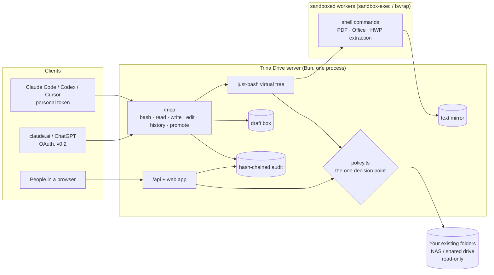

# Architecture

How Trina Drive is built: one Bun server, one decision point for every read, a draft box for every write. The
[README](../README.md) has the short version; the security side is in [SECURITY-MODEL.md](SECURITY-MODEL.md), settings in
[CONFIG.md](CONFIG.md).



## Code layout

```
src/brand.ts       every product name (one place)
src/config.ts      limits, protocol versions, data dir      src/policy.ts   R0 R1 R4 R5 R6 (the one decision point)
src/db.ts          SQLite schema (bun:sqlite)               src/session.ts  one call: touches, pending drafts, commit+audit
src/store.ts       people, groups, folders, rules, tokens   src/vfs.ts      just-bash IFileSystem over the policy
src/names.ts       NFC, system names, office extensions     src/grep.ts     grep/egrep/fgrep/rg → ripgrep --json
src/mirror.ts      text mirror keyed by content sha256      src/shell.ts    Bash instance, read modes, caps
src/drafts.ts      draft box, versions, R4                  src/tools.ts    the five MCP tools
src/audit.ts       hash-chained audit log                   src/mcp.ts      POST /mcp endpoint
src/extract/       pdf (pdftotext), docx/xlsx/pptx, hwpx, hwp (own CFB reader), zip; run.ts = always in an isolated worker
src/rights.ts      R5/R7/R9 admin-side decisions            src/web/        REST API, sessions, mail, notices, server
src/promote.ts     promote (R2 v0.2, R6), approvals (R8)    src/promote-tool.ts  the MCP promote tool's glue
src/web/mfa.ts     passkeys, TOTP, recovery, step-ups       src/web/totp.ts  RFC 6238   src/web/approve.ts  their HTTP side
web/               the admin app (Vite + React, en/ko)
src/samples.ts     generated sample office files            src/demo.ts     demo seed       src/cli.ts  CLI
src/redact.ts      secrets out of audit rows                src/ratelimit.ts  sign-in (SQLite) and /mcp limits
src/client/mcp.ts  `mcp add claude|codex|cursor` (runs on the person's computer)
src/notify/        events, recipients, messages (R11), notifier (inbox, coalescing, rate limit, digest), channels
                   (Slack, outbox, smtp), bulk-read alarm, connections, audit anchor, its CLI and tables (schema.ts)
sim/provenance-day.ts   plan ★8 replay                      test/           bun test
```

## MCP endpoint

`POST /mcp`, Streamable HTTP in its stateless JSON form (one JSON-RPC message per POST, `application/json` reply, no
SSE, no session). Protocol versions `2026-07-28` and `2025-11-25`. `Authorization: Bearer tdrive_pat_…` only (cookies
are never read); foreign `Origin` headers are refused (DNS-rebinding guard); listens on 127.0.0.1 by default.

Rate limits (`src/ratelimit.ts`, `MCP_LIMITS`; plan 7.1): per token 120 requests/min and 4 at once, per source address
600/min and 16 at once, and 30 requests/min with a missing or wrong bearer token per address (after that the address is
refused, valid token or not, until the minute ends). Over a limit: HTTP 429, `Retry-After` (seconds) and a JSON-RPC
error `{code: -32029, message: "rate limit: …", data: {retry_after}}` with the request's id when it was readable.
`serve` and the web server always install a limiter (in memory: a restart ends every request anyway). Addresses are the
TCP peer: behind a reverse proxy every client shares one address.

| tool | what |
|---|---|
| `bash` | `{command}` → stdout, stderr, exit code. just-bash over the virtual tree; `grep`/`egrep`/`fgrep`/`rg` are ripgrep |
| `read` | `{path, offset?, limit?}` text (office files: extracted); drafts also return their sha256 |
| `write` | `{path, content, expected_sha256?}` drafts only |
| `edit` | `{path, old_string, new_string, replace_all?, expected_sha256?}` own drafts only |
| `history` | `{path, action: list\|read\|restore, version?}` draft versions |
| `promote` | `{draft, folder, name, reason?, expected_sha256?}` one of this token's drafts → a NEW file in a team folder; widening → `structuredContent.status: "input_required"` with the approval link (information only; agents cannot approve) |

What the shell sees:

| path / command | sees |
|---|---|
| `/<registered folder>/…` | originals the token may read; hidden = nonexistent (same output, error text, exit code), also when the server fails while deciding (fail closed); other unexpected server errors are a fixed `EIO` |
| `cat head tail grep rg sed awk wc -l`, `read` | extracted text for pdf/docx/xlsx/pptx/hwp/hwpx (stderr notes "(extracted text …)" once) |
| `ls -l stat du wc -c sha256sum md5sum od base64 file` | original bytes |
| `/.raw/<path>` | original bytes of any visible file (not listed at `/`) |
| `/drafts/` | this token's drafts (writable, `.md`/`.csv`/text only); other tokens' visible drafts under `/drafts/@<token>/` (read-only) |
| any other write | refused: "Originals are read-only. Write to /drafts/ and a person will move it." |

Limits per call and per token (`src/config.ts` `LIMITS`): a file read is at most 64 MB and one call reads at most
128 MB of files in all (beyond: `EFBIG`, with the reason on stderr; nothing is read into the server first); a draft is
at most 8 MB; live drafts are at most 500 files / 200 MB per token and 1 GB per person (`EDQUOT`; env
`TDRIVE_DRAFT_MAX_FILES`, `TDRIVE_DRAFT_MAX_BYTES`, `TDRIVE_DRAFT_PERSON_MAX_BYTES`; writes that do not grow a draft
always pass); commands run at most 2 per token, 3 per person and CPUs − 2 overall at once (`TDRIVE_WORKERS_*`, see
[worker.md](worker.md)).

## Web admin

```sh
bun run build:web                                   # web/ (Vite + React) -> web/dist, served by `serve` at /
tdrive --data ./.trina-drive init                   # prints a one-time web setup token (demo seed prints one too)
tdrive --data ./.trina-drive serve --port 8787 [--public-url https://files.example.lan]
open http://127.0.0.1:8787/                         # paste the setup token, create the admin, register folders
```

One Bun server: `/mcp` (Bearer tokens only), `/api` (people's sessions), the app at `/`. Sessions: argon2id
passwords, cookie `tdrive_session` (HttpOnly, SameSite=Strict, `Path=/api`, Secure on https), a CSRF token per session
on every change, same-origin `Origin` required from browsers, JSON bodies only, sign-in rate limit per name (5 failures)
and per address (50 attempts) per 15 minutes, kept in SQLite (`rate_limits`, keys stored as sha256) so a restart does
not reset them; 429 carries `Retry-After`. First setup only with the setup token from `init` (loopback is not trusted). Invite and reset links are
one-time and carry their secret in the `#fragment`. Mail is a pluggable `Mailer`; the built-in one appends to
`<data>/outbox.log`. CSP `default-src 'self'`, `frame-ancestors 'none'`, nosniff, `Referrer-Policy: no-referrer`.

Every handler asks `src/rights.ts` (R5/R7/R9: who may see or change which folder, built on `policy.effectiveLevel`)
or `src/policy.ts` (drafts, R4 with the session as a full-scope token). What the caller may not see is 404.

| | endpoints (`/api`) |
|---|---|
| before sign-in | `GET state`, `POST setup`, `POST login`, `POST links/check`, `POST links/accept` (invite / reset) |
| session | `GET session`, `POST logout`, `POST me/password`, `GET notices`, `POST notices/read` |
| people (admin changes) | `GET people`, `POST people` (→ invite link), `PATCH people/:id` (admin, active, email → old address told), `POST people/:id/invite`, `POST people/:id/reset` (link mailed to the person only; their tokens and sessions are cut) |
| groups (admin) | `POST groups`, `DELETE groups/:id`, `PUT/DELETE groups/:id/members/:pid` |
| folders | `GET folders`, `POST folders` (admin; templates public/team/management/personal/custom, NAS readers all/same-as-ai/chosen/unknown), `GET folders/:id` (the NAS/AI table), `PATCH folders/:id` (no_ai, inherit_break, quarantine, name), `DELETE folders/:id` (admin), `PUT folders/:id/rules`, `PUT folders/:id/nas`, `PUT folders/:id/owner`, `POST folders/:id/subfolders`, `PUT/DELETE folders/:id/managers/:pid` (admin) |
| tokens (own only) | `GET tokens`, `POST tokens` (shown once), `DELETE tokens/:id`, `POST tokens/:id/provenance-reset` ("출처 초기화", below) |
| fresh login | `POST me/reauth` `{password}`: the password typed again counts as a fresh login for 5 minutes (as does signing in) |
| drafts (own, R4) | `GET drafts` (+ locked count and dates), `GET drafts/:id/download` |
| files (read only, R1) | `GET files?path=` (list), `GET files/stat`, `GET files/download` (attachment only), `GET files/text` (extracted, 1 MB), `GET files/who`, `GET search?q=&path=` — see "Files on the web" |
| OAuth consent | `GET oauth/requests/:id`, `POST oauth/requests/:id/approve` `{folders \| all, read_only, ttl}`, `POST oauth/requests/:id/deny` → `{redirect_to}` (src/oauth/consent.ts) |
| audit | `GET audit?view=mine` · `view=folders` (folders you manage; others' command lines hidden) · `view=summary` (admin: who, which connection, how many; hash-chain check) |
| second step of sign-in | `POST login` answers `{second_factor: {ticket, methods, passkey}}` (no cookie) for someone with a second factor; `POST login/second` `{ticket, method: passkey\|totp\|recovery, response\|code}` → session. A reset link (`links/accept`) asks for it too |
| second factors (own) | `GET me/2fa`, `POST me/passkeys/options`, `POST me/passkeys`, `DELETE me/passkeys/:id`, `POST me/totp/setup`, `POST me/totp/confirm`, `DELETE me/totp`, `POST me/recovery-codes` — changes need a fresh login (`POST me/reauth`) |
| promote | `GET promote/targets`, `POST drafts/:id/promote` `{folder, name, expected_sha256?, note?}`, `PUT folders/:id/promote` `{enabled}` (admin) |
| approvals (R8) | `GET approvals`, `GET approvals/:id`, `POST approvals/:id/step-up/options` `{sha256}`, `POST approvals/:id/step-up` `{sha256, response\|code}` → `{assertion}`, `POST approvals/:id/approve` `{sha256, assertion}`, `POST approvals/:id/reject` `{reason}` (the requester: cancel) |

R7 as built: a manage holder edits AI readers and "start fresh here" in their folder and below, and can turn
"No AI" on; NAS readers, "No AI" off, register/unregister, quarantine and manage grants are admin only (personal
folders: NAS readers and "No AI" belong to the owner; nobody sets rules inside them). R9 notices (kind, count, link
only) go to the folder's managers and the admin on self-grants (rule, group, manage, NAS readers), "No AI" off,
personal-folder unregister/owner change, and re-registering a former personal folder.

### Files on the web (plan 5.2, read only)

The **Files** page (파일, `#/files`) is where people who are not admins land: a lazy folder tree, breadcrumb, list or
grid, sort by name/date/size, search over names and text (snippets), a detail panel (size, modified, who can see,
"View text", Download) and a "My drafts" entry that opens the drafts page. Arrow keys / Enter / Backspace in the list.
Code: `src/web/files.ts`, `web/src/pages/Files.tsx`.

- **One decision point.** Every endpoint walks with `Access.forPerson` (`src/policy.ts`): the person's session is a
  token of their own whose scope is everything (the same rule as the drafts page). Admins get no extra reads here.
- **"No AI" is for AI only.** A No-AI folder stays open on the web to people whose rules let them read it (plan 5.1
  "AI 연결 금지(웹의 사람만)"); their agents still see nothing. Quarantine and "widened, waiting" close it on the web too
  (stricter than the plan's "agents only" for widened copies), as do links, hard links, NAS system folders and NFC
  collisions.
- **Hidden == missing**: 404 with the same body and headers on list, stat, download, text, who and search scope.
  Folders show no size or time (they would move with files you cannot see). A folder you see only as the way to a
  readable subfolder lists only that child, and its "who can see" is withheld.
- **Bytes**: opened without following links and re-checked (R1 ⑦) before they leave; downloads are always
  `Content-Disposition: attachment`, `application/octet-stream`, `nosniff`, `CSP: sandbox`, `no-store` (64 MB cap,
  read into memory). Nothing a file holds is rendered on this origin: extracted text is a JSON string shown as plain
  text; a preview needs a separate origin and sandbox (plan 7.1, v0.3).
- **Search**: walks only what the person may see (≤ 5,000 files, 2,000 folders), fills the text mirror on first use
  within 15 s, runs ripgrep (fixed string, case-insensitive) over exactly those mirror files, re-checks each file
  before its snippet leaves; 50 results, 3 snippets each; `partial` when a limit was hit.
- **Audit, no provenance.** Every call is an audit row (`tool: web`, no token, `files <action> <path>`, files whose
  content left; failures as `not_found`), and if the row cannot be written nothing is returned. Web reads open **no
  provenance window** (R3): provenance labels what an agent's token touched so its drafts carry their sources; a person
  in a browser writes no drafts through this server.

See [Draft promote and approvals](#draft-promote-and-approvals-v02) and [Second factors](SECURITY-MODEL.md#second-factors-passkeys-totp)
for the last four rows.

Web tables (created on demand by `src/web/schema.ts`, not in `db.ts`): `accounts`, `web_sessions`, `web_links`,
`notices`, `folder_history`, `web_reauth`; `rate_limits` (src/ratelimit.ts); keys `web_setup_token` and `everyone_group` in `meta`.

## Draft promote and approvals (v0.2)

Plan 5.2 "초안 반영 + 승인함", 4.1 R2 (v0.2), R6, R8, R11, principle 5. Code: `src/promote.ts` (deciding and writing),
`src/promote-tool.ts` (MCP), `src/web/approve.ts` (web), `web/src/pages/Approvals.tsx`.

- **Where.** A folder takes promoted drafts when the admin turned **promote** on for it or a folder above it
  (`PUT /api/folders/:id/promote`, the folder page, or `folder promote <path>`; never inside a personal folder). Decision:
  admin only for now — R7 lets `manage` change rules, but promote decides where the server's NAS account writes (5.2: that
  account has write only on promote folders), which is an admin matter. The person's effective rule there must be
  `write` (R2: in v0.2 `write` marks where a person's drafts may land), and the target must be readable in the caller's
  view (the token's, for an agent: scope, flags, "No AI"). A hidden target answers like a missing one.
- **What.** NEW files only (overwrite is v0.3): text names (`.md .markdown .txt .csv .tsv .json .yaml .yml .log`), no
  path, no hidden/system/temporary name, ≤ 255 bytes; refused when a name equal after NFC and case-folding (or its
  `._` sidecar) is there; content that looks like an XSym / alias link is refused. `expected_sha256` pins the version.
- **Not widening** (R6 with S ≠ F on R5 readers; no sources = not widening): written at once. The bytes go to a temp
  file `~$trina-drive-promote-….tmp` in the target folder (`O_EXCL|O_NOFOLLOW`, fsync), the folder chain is re-checked
  (identity, no links), then `link(temp, final)` — which refuses an existing name, so it is a rename that never
  replaces — and the temp is unlinked; shares without hard links get an exclusive create of the final name. The draft's
  current version is checked right before (base hash) and the result after (regular file, one link, same bytes). The
  promotion and its audit row are written in the call's transaction; if that fails the file is removed again. The
  file's identity is recorded as a **tracked copy** of the draft (`widened`, `match = 'promote'`): whoever reads it
  inherits Src(d) (R3), and R6 re-judges it when rules change, exactly as with copies the reconciler finds.
- **Widening**: an approval request (`approvals`), status `pending`, 7 days. The bytes are the content-addressed blob
  of that version (kept). The agent gets `Pending approval … <public url>/#/approvals/<id> … You cannot approve it`
  (`structuredContent.status: "input_required"` — information only). The same draft version, target and name again
  is the same request; at most 20 pending per person. **No eligible approver → `closed`** ("no one can approve") at once.
- **Who approves (R8, judged at every view and again at the click).** A person with a web sign-in (never a token) who can
  read every source folder by rule with no flag on it or above (agents' R1 ①–③: "No AI", quarantine, widened-pending
  all count) **and** manages the target folder **or** every source folder. Their own request only by the second way.
  Admins are not stand-ins. Sources = Src at request time ∪ what the draft gained since.
- **What they see.** Eligible approvers: the sources by name, who gains access (count and names), the requester and
  token, the content as plain text (`<pre>` text, never HTML; 256 KB) and a diff against nothing, and the agent's reason
  folded away as "Agent's claim (not verified)". The requester: status, their sources (hidden ones counted), no names of
  other people, cancel. Other managers of the target or a source: only "N pending" on the inbox (R11). Anyone else: 404.
- **Approve** = `step-up/options` → passkey (`userVerification: required`) → `step-up` returns a random assertion
  (2 minutes, single use, stored as sha256, bound to session + person + approval id + version hash) → `approve`
  consumes it, then re-judges everything: R8 for the approver, the draft still at that hash (else the request closes as
  `stale`), the target still there / not quarantined / promote still on, the requester still with `write`, the name
  still free (else `failed`). Writes exactly the stored bytes as above; the copy is recorded `confirmed`.
  **Reject** needs a reason (the requester sees it); no step-up (it writes nothing).
- **Browser agents (7.1).** Every approve click needs a fresh passkey assertion bound to that request: a browser agent
  driving a signed-in session cannot produce one. No magic links: notifications carry `<baseUrl>/#/approvals` only.
  Bearer tokens are never read under `/api`; CSRF + same-origin `Origin` as everywhere.
- **Passkeys vs LAN.** Passkeys need the public https address (`serve --public-url https://…`; its host is the RP ID).
  With one, approvals require a passkey (an authenticator code is not accepted). Without one (LAN-only install), approvals
  step up with the authenticator app (TOTP, each code once) and the page says so. Recovery codes never approve.

## In-place reconciler

Plan 2.2, R1 ⑤–⑦, R6, R10, 11-9.

`src/inplace/`. Walks the registered folders (and `share add` roots: the whole share, identity + hash only) with lstat,
never following links and skipping NAS system folders; diffs against the last walk by identity (dev+ino, birth time).

| finding | what happens |
|---|---|
| rename (same identity, same parent), move that does not widen | rules follow the identity; folder paths updated |
| move whose new readers (R5 target) are wider than the old location's (R5 source) | identity quarantined (`quarantine` kind `moved`) + event for admins and old-location managers |
| a rule-bearing folder's identity vanished | its last path stays closed for any other identity (`lost`), rules stay on the lost id |
| symlink, hard link, identity at 2+ paths, XSym file, Mac alias (data or AppleDouble Finder info), NFC collision | closed (`fs_index.closed`) + one `closed` event per reason per pass |
| new/changed file | sha256 (small first), text mirror filled (queue, 2 at a time), compared with every draft version: same sha256 or ≥ 30% paragraph overlap → `widened` row; if `isWidening(Src(d), folder)` → `pending` (closed to agents) until the admin or a manager of every source confirms; confirmed/tracked copies pass Src(d) on to readers |
| any outside change | one `outside-change` row in the audit chain (`~$*`, `.~lock.*#`, `~WRL*.tmp`, `.DS_Store`, `._*` filtered) |

Between passes the policy closes anything the index saw at another path (moved since) and asks for a pass; XSym/alias
bytes are refused at read time. `serve` reconciles on start, every 5 min (`--reconcile-every`) and on fs.watch hints.
10k small files on a local SSD: first pass ≈ 0.8 s (identity + sha256), ≈ 4 s with the text mirror; unchanged pass ≈ 0.2 s
(`bun test test/reconcile-bench.test.ts` prints it).

## Dependencies and licenses

| | license | how |
|---|---|---|
| just-bash 3.6.0 (vercel-labs) | Apache-2.0 | runtime; its runtime tree is MIT/ISC/Apache-2.0/BSD, plus optional native `node-liblzma` (LGPL-3.0) and `@mongodb-js/zstd` |
| ripgrep | MIT / Unlicense | external binary |
| poppler `pdftotext` | GPL-2.0/3.0 | external binary, separate process (not linked) |
| HWP/HWPX extractor | own code (adapted from Team AX `server/src/files/hwp.ts`, same owner) | the CFB reader replaces SheetJS |
| @modelcontextprotocol/sdk 1.32 | MIT | tests only (as the HTTP client); the server endpoint is hand-written because 1.32 does not know protocol 2026-07-28 |
| @simplewebauthn/server 13.3.3 | MIT | runtime (passkeys); its tree: @peculiar/* MIT, @hexagon/base64 MIT, @levischuck/tiny-cbor MIT, asn1js BSD-3-Clause, pvtsutils/pvutils MIT, tslib 0BSD, reflect-metadata Apache-2.0, tsyringe MIT |
| typescript, @types/bun | Apache-2.0, MIT | dev |
